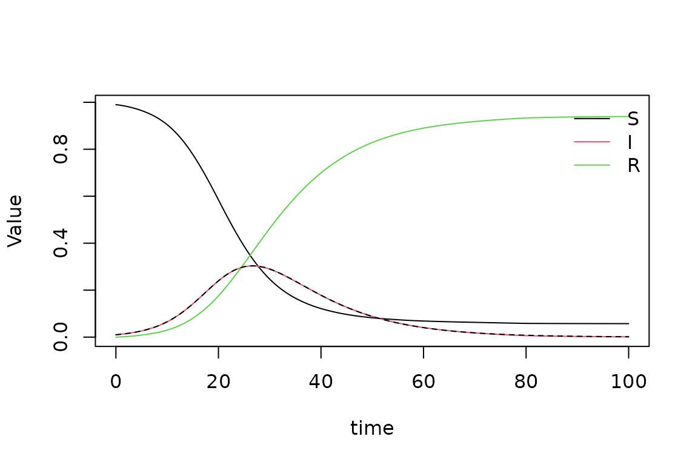
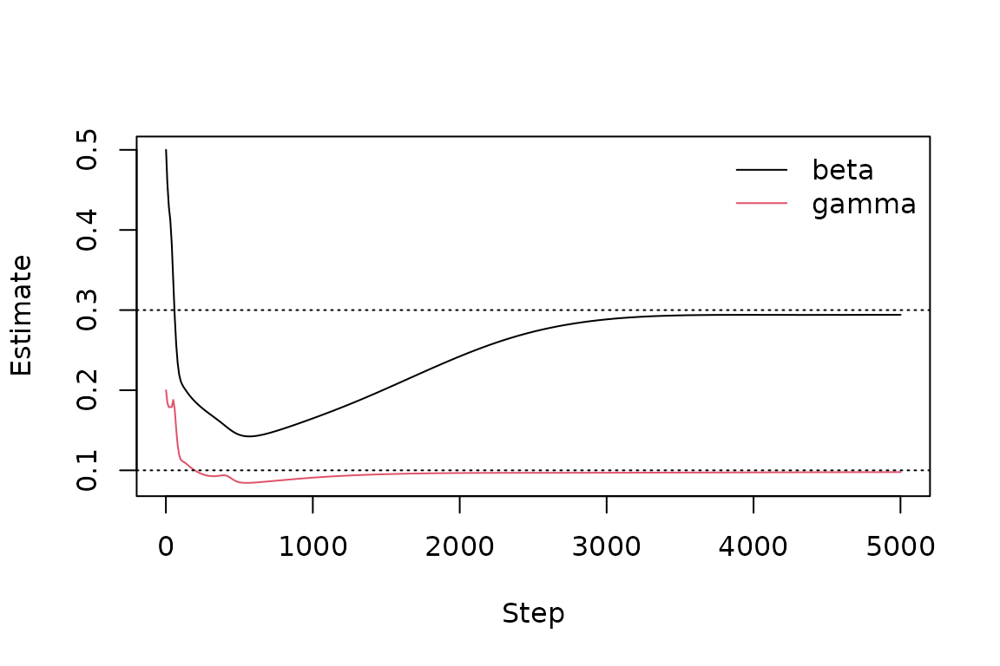

# Getting started with pinnr

A physics-informed neural network (PINN) is a neural network trained to
satisfy a differential equation. Instead of stepping through time like a
classical solver, it learns a smooth function whose derivatives make the
equation hold at many sampled points, while also matching boundary
conditions, initial conditions and, optionally, observed data. Because
unknown constants can be learned alongside the network, the same tool
solves an equation *and* estimates its parameters from data.

`pinnr` does this in native R on top of `torch`. This vignette walks
through three typical uses:

1.  solving an ordinary differential equation (ODE) written for
    `deSolve`,
2.  estimating ODE parameters from noisy observations, and
3.  solving a partial differential equation (PDE).

``` r

library(pinnr)
```

If you have not used `torch` before, install its backend once with
[`torch::install_torch()`](https://torch.mlverse.org/docs/reference/install_torch.html).

## 1. Solving an ODE from a deSolve model

Here is the classic SIR epidemic model, written exactly as you would for
[`deSolve::ode()`](https://rdrr.io/pkg/deSolve/man/ode.html):

``` r

sir <- function(t, y, parms) {
  with(as.list(c(y, parms)), {
    dS <- -beta * S * I
    dI <- beta * S * I - gamma * I
    dR <- gamma * I
    list(c(dS, dI, dR))
  })
}
y0 <- c(S = 0.99, I = 0.01, R = 0)
parms <- c(beta = 0.3, gamma = 0.1)
times <- seq(0, 100, by = 1)
```

[`pinn_ode()`](https://obasanmii.github.io/pinnr/reference/pinn_ode.md)
turns it into a PINN problem. The initial state is built into the
network, so only the equation itself has to be learned.

``` r

prob <- pinn_ode(sir, y0 = y0, times = times, parms = parms)
prob
#> <pinn_problem>
#>   Domain:     time in [0, 100]
#>   Outputs:    S, I, R
#>   Parameters: beta = 0.3, gamma = 0.1
#>   Output transform: yes
```

Epidemics that start from a handful of cases are hard for PINNs over
long horizons: a network can find a nearly flat curve with a small
residual. Splitting the time range into windows and training them in
sequence (“time marching”) avoids this.

``` r

fit <- pinn_fit(prob, windows = 5, seed = 1)
fit
#> <pinn_fit>
#>   Outputs S, I, R on time in [0, 100]
#>   Network 1-32-32-32-3, tanh activation
#>   Time marching over 5 windows
#>   Trained 5000 Adam steps per window in 235.4 s
#>   Final loss (worst window) 4.735e-08 (residual 4.735e-08, conditions 0, data 0)
```

Compare with `deSolve`:

``` r

ref <- as.data.frame(deSolve::ode(y0, times, sir, parms))
pred <- predict(fit)
max(abs(as.matrix(pred[c("S", "I", "R")]) - as.matrix(ref[c("S", "I", "R")])))
#> [1] 0.002089985

plot(fit, type = "solution")
lines(ref$time, ref$I, lty = 2)
```



## 2. Estimating parameters from data

Suppose we only observe the infected and recovered fractions every five
days, with measurement noise, and want to estimate `beta` and `gamma`.

``` r

set.seed(42)
obs <- ref[ref$time %% 5 == 0, c("time", "I", "R")]
obs$I <- obs$I + rnorm(nrow(obs), sd = 0.005)
obs$R <- obs$R + rnorm(nrow(obs), sd = 0.005)
head(obs)
#>    time          I            R
#> 1     0 0.01685479 -0.008906542
#> 6     5 0.02353904  0.007607310
#> 11   10 0.06721241  0.036184205
#> 16   15 0.14465968  0.089668878
#> 21   20 0.24189748  0.173530409
#> 26   25 0.29943608  0.312187441
```

Give starting guesses in `unknown` and the observations in `data`. The
derivative function is unchanged; `beta` and `gamma` are now learned.

``` r

inv <- pinn_ode(sir, y0 = y0, times = times,
                unknown = c(beta = 0.5, gamma = 0.2), data = obs)
fit_inv <- pinn_fit(inv, epochs = 5000, seed = 1)
coef(fit_inv)
#>       beta      gamma 
#> 0.29416921 0.09781107
```

The true values are `beta = 0.3` and `gamma = 0.1`. The estimates’ path
during training is useful for judging convergence:

``` r

plot(fit_inv, type = "parameters")
abline(h = c(0.3, 0.1), lty = 3)
```



Observations do not have to cover every state: here `S` was never
observed. Missing values (`NA`) in `data` are also ignored, so different
states can be measured at different times.

## 3. Solving a PDE

For PDEs, describe the domain, the residual and the conditions directly.
The residual is an ordinary R function whose arguments are matched by
name to outputs (`u`), variables (`x`, `t`) and parameters (`a`). The
function `d()` takes derivatives: `d(u, t)` is $`\partial u/\partial t`$
and `d(u, x, x)` is $`\partial^2 u / \partial x^2`$.

The heat equation $`u_t = a\,u_{xx}`$ on $`0 \le x \le 1`$, with
$`u(x, 0) = \sin(\pi x)`$ and $`u = 0`$ at both ends, has the exact
solution $`u = e^{-a\pi^2 t}\sin(\pi x)`$.

``` r

heat <- pinn_problem(
  domain = pinn_domain(x = c(0, 1), t = c(0, 1)),
  outputs = "u",
  residual = function(u, x, t, a, d) d(u, t) - a * d(u, x, x),
  conditions = list(
    pinn_initial(function(x) sin(pi * x), time = "t"),
    pinn_dirichlet(where = list(x = "both"), value = 0)
  ),
  parms = list(a = 0.1)
)
fit_heat <- pinn_fit(heat, epochs = 5000, seed = 1)

grid <- expand.grid(x = seq(0, 1, length.out = 51), t = seq(0, 1, length.out = 51))
pred <- predict(fit_heat, grid)
max(abs(pred$u - exp(-0.1 * pi^2 * grid$t) * sin(pi * grid$x)))
#> [1] 0.006326235
plot(fit_heat, type = "solution")
```


[`residuals()`](https://rdrr.io/r/stats/residuals.html) shows where the
equation is satisfied least well, which is a useful diagnostic when no
exact solution is available:

``` r

res <- residuals(fit_heat, grid)
summary(abs(res$residual_u))
#>      Min.   1st Qu.    Median      Mean   3rd Qu.      Max. 
#> 9.127e-06 4.437e-03 5.434e-03 5.858e-03 6.983e-03 4.144e-02
```

## Tips

- **Write tensor-friendly code.** Inside residual, condition and ODE
  functions the arguments are torch tensors. Arithmetic and functions
  such as `sin`, `exp`, `log` and `sqrt` work; `if`, `ifelse`, `max` and
  `pmin` on these values do not.
- **When the loss stalls,** try more `epochs`, a larger network
  (`hidden`), more collocation points (`n_collocation`), or follow Adam
  with L-BFGS (`lbfgs_iter = 500`). `plot(fit)` shows the loss history.
- **Scale your problem.** PINNs train best when inputs and outputs are
  of order one. Inputs are rescaled automatically; rescale outputs that
  are very large or small.
- **Saving.** Use
  [`pinn_save()`](https://obasanmii.github.io/pinnr/reference/pinn_save.md)
  and
  [`pinn_load()`](https://obasanmii.github.io/pinnr/reference/pinn_save.md),
  because torch modules cannot be saved with
  [`saveRDS()`](https://rdrr.io/r/base/readRDS.html) alone.
- **Hardware.** Pass `device = "cuda"` or `device = "mps"` to train on a
  GPU.
